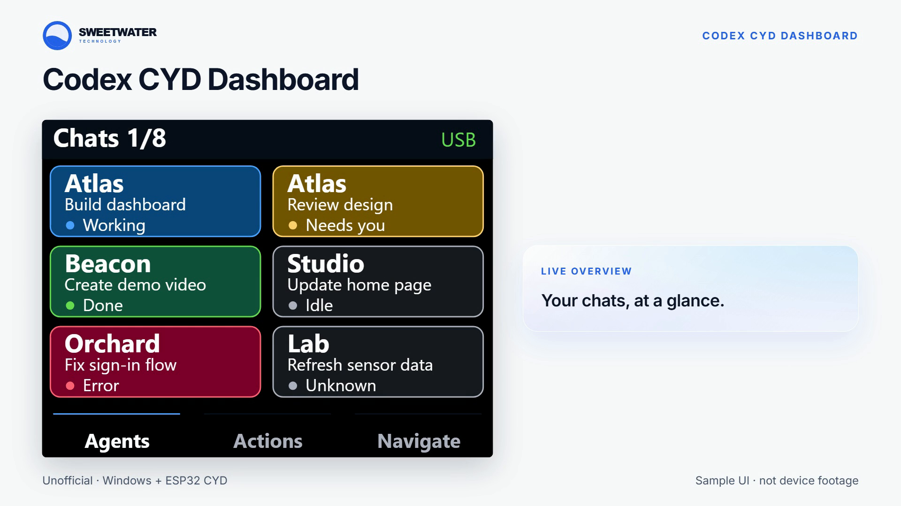
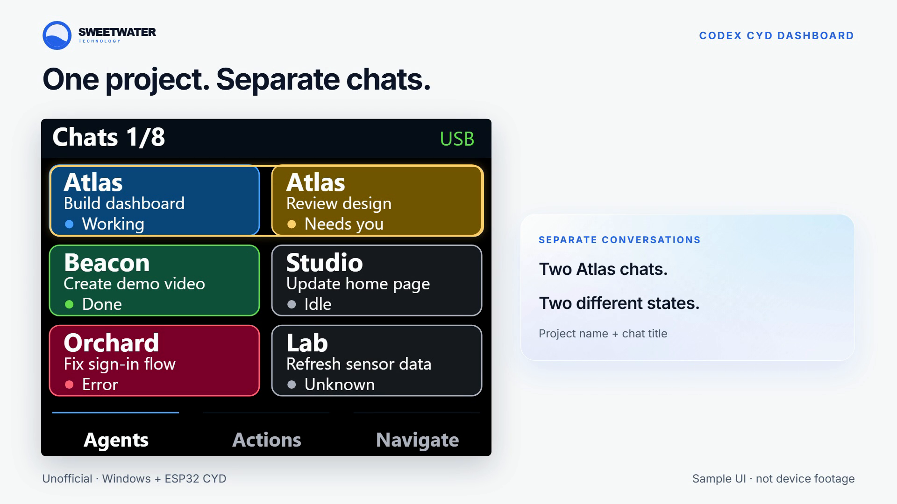

# Codex CYD Dashboard

[](https://github.com/boilermanc/codex-cyd-dashboard/actions/workflows/ci.yml)

A touchscreen view of your local Codex chats on an ESP32 Cheap Yellow Display. Built by [Sweetwater Technology](https://sweetwater.technology/resources/).



[Watch the 26-second demo](https://github.com/boilermanc/codex-cyd-dashboard/raw/refs/heads/main/docs/media/demo.mp4)

Each card shows its project, shortened chat title and live status. Multiple chats in the same project get separate cards. Tap a card to open that exact chat on your Windows computer. Tap the Chats heading or the Agents tab to move through pages of six chats.

| Card | Meaning |
| --- | --- |
| Blue - Working | Chat is actively running |
| Amber - Needs you | Waiting for your input or approval |
| Green - Done | Finished with an unread result |
| Gray - Idle | Not running |
| Red - Error | Runtime system error |
| Gray - Unknown | No fresh live status available |



## Supported hardware and software

- ESP32-2432S028R, ESP-WROOM-32, ILI9341 320×240 display, XPT2046 resistive touch, 4 MB flash.
- Windows 11 with Codex desktop. Local chats only; remote/cloud chats are not supported.
- Python 3.11+ and PlatformIO Core. A USB data cable is required.
- Bluetooth is optional for the Actions and Navigate tabs. Agent cards use USB, independent of unnamed Micro Bluetooth slots.

Boards with ST7789 displays or ESP32-S3 processors need different firmware. Check your board before flashing. The tested display needs `TFT_RGB_ORDER=TFT_RGB`; other ILI9341 batches may use BGR.

## Install

1. Clone this repository and open PowerShell in its folder.
2. Create the helper environment:

   ```powershell
   py -3.11 -m venv .venv
   .\.venv\Scripts\python.exe -m pip install -r requirements.txt
   ```

3. Install PlatformIO Core separately, then build:

   ```powershell
   py -m pip install platformio==6.2.0
   pio run -e cyd
   ```

4. Back up the existing device before replacing its application; see [installation and recovery](docs/INSTALL.md). Find its serial port in Windows Device Manager. Flash only the intended board:

   ```powershell
   pio run -e cyd --target upload --upload-port COM11
   ```

   Replace `COM11` with your device's port. Startup prints `CODEX_CYD_READY`.

5. Keep Codex desktop open and start the helper:

   ```powershell
   .\Start-USB-Helper.ps1 -Port COM11
   ```

   The green USB indicator means the helper is connected. To stop: `.\Stop-USB-Helper.ps1`.

For foreground diagnostics:

```powershell
.\.venv\Scripts\python.exe scripts/usb-helper.py --port COM11
.\.venv\Scripts\python.exe scripts/usb-helper.py --dry-run --seconds 20
```

An optional `--device-id` (or launcher `-DeviceId`) pins the MAC-derived 12-digit identity reported by `CYD_HELLO`. The helper accepts protocol-v1 firmware on the explicitly selected port; it never scans or writes other ports. `--codex-home` overrides the local Codex data folder, defaulting to `CODEX_HOME` or `~/.codex`.

## Controls

Agents: chat cards and paging. Actions: upstream BLE shortcuts for Fast, approval, rejection, fork, microphone and send. Navigate: BLE navigation/dial controls. Configure those bindings in Codex Micro settings after Bluetooth pairing. The helper never sends prompts or approvals. BOOT short-press rotates the display 180 degrees. BOOT long-press starts touch calibration. The current dashboard keeps the screen awake at full brightness.

## Compatibility and privacy

This is an unofficial extension of [roflsunriz/esp32-codex-notifications](https://github.com/roflsunriz/esp32-codex-notifications), based on commit `a96b80c5b8375aa347bed1826807d5c3b4b89b28`. It uses an undocumented local Codex IPC pipe and a read-only `state_5.sqlite` connection, tested against desktop 26.1007.2314.0. Future app updates may require changes.

The helper receives snapshots in memory but does not save message bodies or credentials. Ignored `.local/` health reports include chat titles and IDs; do not share them without reviewing them. No OpenAI API key or cloud service is required. Lost status becomes Unknown; lost USB becomes Offline and disables taps. Taps are tied to the displayed chat ID and helper session, so reordered cards cannot open another chat.

Screenshots and video are labeled fictional sample UI, not photographs or captures of the physical device. They illustrate the layout; device fonts may differ. The public firmware uses the bundled openly licensed Atkinson Hyperlegible font.

## Development

```powershell
.\.venv\Scripts\python.exe -m unittest discover -s test -p "test_*.py"
pio run -e cyd
cmake -S . -B build
cmake --build build --config Release
ctest --test-dir build -C Release --output-on-failure
```

C++ host tests need a C++17 compiler and CMake. Font regeneration additionally needs Pillow (`pip install Pillow`) and `python scripts/generate-fonts.py`. See [verification](docs/VERIFICATION.md), [contributing](CONTRIBUTING.md) and [security](SECURITY.md).

## License and credits

Firmware and helper: MIT, preserving upstream notices in [LICENSE](LICENSE) and [NOTICE.md](NOTICE.md). Font: SIL Open Font License in `assets/fonts/OFL.txt`. Sweetwater branding remains owned by Sweetwater Technology. Demo music was synthesized locally for this project. This project is not endorsed by OpenAI, Work Louder or Espressif.
